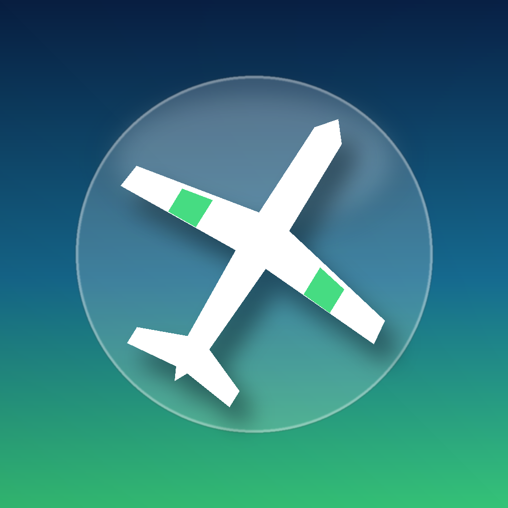

<p align="center">
  
</p>

<h1 align="center">SmartPlane PRO – Community Control</h1>

<p align="center">
  Eine moderne iOS-26-App (Liquid Glass, SwiftUI) für das <b>TobyRich SmartPlane PRO</b> –
  weil die Original-App aus dem App Store verschwunden ist.
</p>

---

## Was die App kann

| Bereich | Funktionen |
|---|---|
| **Cockpit** | Künstlicher Horizont, Gashebel mit Haptik, **Neigungssteuerung** (funktioniert in Hoch- und Querformat) oder **Ruder-Joystick**, Gamepad-Unterstützung (Xbox/PlayStation/MFi), Akku (mit Spannungseinbruch-Korrektur), Ladestatus, Temperatur, Signalstärke, Flugzeit |
| **Sicherheit** | Motor muss per **Gedrückthalten scharfgeschaltet** werden (nur bei 0 % Gas), **STOP/Not-Aus** immer sichtbar, Motor geht beim Verlassen der App und bei Verbindungsverlust sofort aus |
| **Flight Assist** | Wie im Original: Linksruder-Dämpfung und Zusatzschub in Kurven, dazu Expo, Totzone, Trimmung, Ruder-Umkehr, Gas-Rampe, Gas-Limit |
| **Stunts** | Looping, Steilkurve 360°, Spirale, Liegende Acht, Slalom, Turbo-Boost, Steigflug, Sanfte Landung |
| **Flugschule & Systemcheck** | Checklisten, Start-/Landetipps, und ein **Hardware-Test** (Ruder links/rechts, Motor 20 %), der prüft, ob das Protokoll passt |
| **Bluetooth-Labor** | Scannt **alle** BLE-Geräte, zeigt Advertisement-Daten, Hersteller, RSSI-Verlauf, liest die komplette **GATT-Tabelle** (Services, Characteristics, Descriptors), **Device Information** (Hersteller, Modell, Seriennummer, Firmware/Hardware-Revision, System-ID, PnP-ID), **Firmware-Image-Header über TI OAD**, Notifications, Hex-Schreiben, **Live-Regler** zum Protokoll-Finden und **manuelle Motor/Ruder-Zuordnung**, exportierbarer Bericht & Log |

## Das Protokoll (Reverse Engineering)

TobyRich hat 2014/2015 die Android-App und die SmartLink-Bibliothek unter BSD-Lizenz veröffentlicht
([app-smartplane-android](https://github.com/TobyRich/app-smartplane-android),
[lib-smartlink-android](https://github.com/TobyRich/lib-smartlink-android)).
Daraus stammen die UUIDs und Wertebereiche, die diese App nutzt:

| Funktion | UUID | Format |
|---|---|---|
| Steuer-Service | `75B64E51-F171-4ED1-921A-476090D80BA7` | – |
| Motor | `75B64E51-0010-4ED1-921A-476090D80BA7` | UInt8 `0…254`, Write **ohne** Antwort |
| Ruder | `75B64E51-0021-4ED1-921A-476090D80BA7` | Int8 `−126…+126` (0 = Mitte, + = rechts), Write ohne Antwort |
| Temperatur | `75B64E51-0030-…` | lesen |
| Ladestatus | `75B64E51-0040-…` | UInt8, `0` = lädt nicht |
| Akku | `180F` / `2A19` | Prozent, Notify |
| Geräteinfo | `180A` (`2A25` Seriennummer, `2A23` System-ID …) | lesen |
| Firmware (TI OAD) | `F000FFC0-0451-4000-B000-000000000000` | Image-Header über `FFC1` |

Zusätzlich erkennt die App das **PowerUp-3.0-Protokoll** (`86C3810E-F171-…`, gleiche Firmware-Familie),
den frühen **SML1-Prototyp-Service** und – per Heuristik – jede SmartLink-Variante mit `…-F171-…`-Service
und `-0010-`/`-0021-`-Characteristics. Details: [docs/PROTOCOL.md](docs/PROTOCOL.md).

> **Wichtig:** Die öffentlich dokumentierten UUIDs stammen vom ursprünglichen SmartPlane.
> Falls die PRO-Firmware abweicht, findest du das im **Systemcheck** heraus und kannst im
> **Bluetooth-Labor** Motor und Ruder mit dem Live-Regler finden und dauerhaft zuordnen.
> Teile gern den exportierten Bericht – dann kann das Profil fest eingebaut werden.

## IPA bauen & installieren

Jeder Push auf `main` startet **GitHub Actions → „Build iOS IPA“** (macOS-26-Runner, Xcode 26):

1. Projekt wird mit [XcodeGen](https://github.com/yonaskolb/XcodeGen) aus `project.yml` erzeugt
2. Release-Build für `iphoneos` ohne Signatur
3. Die **unsignierte IPA** landet als Artefakt im Workflow-Lauf **und** im Pre-Release
   **„latest“** unter *Releases* (bei Tags `v*` als richtiges Release)

Manuell starten: *Actions → Build iOS IPA → Run workflow*.

**Installation** der unsignierten IPA (wird beim Installieren mit deiner Apple-ID signiert):

- **Sideloadly** (Mac/Windows) oder **AltStore / SideStore**: IPA auswählen, mit Apple-ID signieren, installieren
- **TrollStore** (falls verfügbar): IPA direkt öffnen
- Mit kostenloser Apple-ID läuft die App 7 Tage, dann neu signieren

Bluetooth-Zugriff beim ersten Start erlauben.

## Lokal entwickeln

```bash
brew install xcodegen
xcodegen generate
open SmartPlanePro.xcodeproj
```

Voraussetzung: Xcode 26 (iOS-26-SDK für Liquid Glass). Mindestversion der App ist iOS 18 –
auf iOS 18 fällt die Oberfläche automatisch auf Material-Effekte zurück.

## Projektstruktur

```
SmartPlanePro/
├─ App/          App-Einstieg, Objektgraph
├─ BLE/          CBCentralManager, GATT-Discovery, UUID-Katalog
├─ Plane/        Protokoll-Profile, PlaneLink (Senden/Telemetrie), Firmware/OAD
├─ Flight/       FlightController (Mixer, Assist, Arming), Neigung, Gamepad, Stunts, Einstellungen
├─ Views/        Cockpit · Stunts/Flugschule/Systemcheck · Labor · Einstellungen
└─ Support/      Liquid-Glass-Helfer, Log, Datenformatierung
```

## Hinweise

Inoffizielles Community-Projekt, nicht mit der TobyRich GmbH verbunden. Fliege verantwortungsvoll,
nie über Menschen, und beachte die lokalen Regeln für Modellflug.
